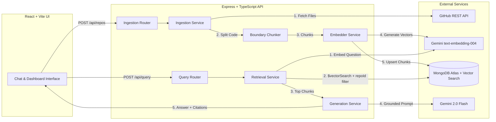

# AI Codebase Assistant

<p align="center">
  
  
  
  
  
  
  
  
</p>

An intelligent, full-stack **Retrieval-Augmented Generation (RAG)** application that indexes public GitHub repositories and answers technical questions about the codebase — complete with precise file and line-range citations back to the source on GitHub.

---

## 🌟 Key Features

- 🔍 **Semantic Code Search** — Ask natural-language questions (e.g., *"How is user authentication implemented?"* or *"Where does data validation happen?"*) and retrieve relevant code chunks even when you don't know the exact identifiers.
- 🎯 **Line-Accurate Citations** — Every generated answer includes clickable citations detailing the exact file path and line numbers, directly linking to GitHub.
- 🧩 **Language-Aware Chunking** — Employs function- and class-boundary detection (with graceful fallback to sliding-window chunks) so code context remains coherent and meaningful.
- ⚡ **Hash-Based Deduplication** — Calculates content hashes for each chunk to ensure unchanged files are never re-embedded on repeat index operations.
- 🛡️ **Prompt Injection Guardrails** — Retrieved code chunks are isolated and treated as untrusted context, preventing injected instructions in user repositories from overriding system prompts.
- 🏗️ **Repository Architecture Summaries** — Automatically inspects codebases upon ingestion to present tech stack badges, key modules, and recommended starter questions.
- 💬 **Interactive Chat & History** — Sleek dark-mode interface with Markdown rendering, syntax highlighting, one-click code copying, and conversation session persistence.

---

## 🏛️ System Architecture



---

## 🛠️ Tech Stack

| Layer | Technology | Details |
| --- | --- | --- |
| **Frontend** | React 18, TypeScript, Vite, Tailwind CSS | Lucide icons, Prism syntax highlighting, React Markdown |
| **Backend** | Node.js, Express, TypeScript | REST API, Winston logging, async pipeline orchestration |
| **LLM** | Google Gemini 2.0 Flash (`@google/genai`) | Low-latency response generation with source grounding |
| **Embeddings** | Google `text-embedding-004` | 768-dimensional dense vector embeddings |
| **Vector Database** | MongoDB Atlas Vector Search | `$vectorSearch` with cosine similarity and tenant `repoId` filtering |
| **Source Ingestion** | GitHub REST API | Octokit-compatible file tree extraction, blob fetching, SHA tracking |
| **Testing** | Vitest, Supertest | 49 unit and integration tests |

---

## 🚀 Getting Started

### Prerequisites

- [Node.js](https://nodejs.org/) (v18 or higher)
- [MongoDB Atlas](https://www.mongodb.com/atlas) account (Free M0 cluster is sufficient)
- [Google Gemini API Key](https://aistudio.google.com/app/apikey)
- [GitHub Personal Access Token](https://github.com/settings/tokens) *(optional, but recommended to avoid rate limits)*

### 1. Clone Repository

```bash
git clone https://github.com/your-username/AIcodebaseAssistant.git
cd AIcodebaseAssistant
```

### 2. Install Dependencies

You can install root, client, and server dependencies in one command:

```bash
npm run install:all
```

*(Or individually run `npm install` inside the root, `client/`, and `server/` directories).*

### 3. Environment Configuration

Create a `.env` file in the project root:

```bash
cp .env.example .env
```

Configure the following variables in `.env`:

```env
# MongoDB Atlas connection string
MONGODB_URI=mongodb+srv://<username>:<password>@<cluster>.mongodb.net/codebase-assistant?retryWrites=true&w=majority

# Gemini API key (https://aistudio.google.com/app/apikey)
GEMINI_API_KEY=your_gemini_api_key_here

# GitHub Personal Access Token (optional but raises rate limit from 60 to 5000 req/hr)
GITHUB_TOKEN=your_github_token_here

# Server Port
PORT=3001

# Allowed Client Origin (CORS)
CLIENT_URL=http://localhost:5173
```

*(Optional) Configure `client/.env.local` if your backend runs on a custom URL:*
```env
VITE_API_URL=http://localhost:3001
```

---

## 🍃 MongoDB Atlas Vector Search Index Setup

For semantic search to function, you need to create a Vector Search Index on the `chunks` collection in your MongoDB Atlas cluster.

1. Navigate to **Atlas UI** → **Browse Collections** → select `codebase-assistant` database → `chunks` collection.
2. Go to the **Atlas Search** or **Vector Search** tab and click **Create Search Index**.
3. Choose the **JSON Editor** and name the index:
   ```text
   embedding_index
   ```
4. Paste the following configuration:

```json
{
  "fields": [
    {
      "type": "vector",
      "path": "embedding",
      "numDimensions": 768,
      "similarity": "cosine"
    },
    {
      "type": "filter",
      "path": "repoId"
    }
  ]
}
```
5. Click **Next** and **Create Vector Search Index**. The index will become active in 1–2 minutes.

---

## 💻 Running the Application

### Development Mode

Run both the frontend and backend concurrently from the project root:

```bash
npm run dev
```

- **Frontend Client**: [http://localhost:5173](http://localhost:5173)
- **Backend API**: [http://localhost:3001](http://localhost:3001)

Or run them individually in separate terminals:

```bash
# Server terminal
npm run dev:server

# Client terminal
npm run dev:client
```

### Running Tests

Run the backend test suite:

```bash
npm test
```

### Production Build

Build both client and server:

```bash
npm run build
```

---

## 📁 Project Structure

```text
AIcodebaseAssistant/
├── client/                      # React frontend
│   ├── src/
│   │   ├── components/          # UI components (ChatBox, MessageBubble, RepoInput, etc.)
│   │   ├── hooks/               # Custom hooks (useRepo, useQuery)
│   │   ├── services/            # API client layer
│   │   └── types/               # Frontend TypeScript interfaces
│   ├── index.html
│   └── vite.config.ts
├── server/                      # Express backend
│   ├── src/
│   │   ├── config/              # Environment and DB connection
│   │   ├── models/              # Mongoose schemas (Repo, Chunk, ChatSession)
│   │   ├── routes/              # Express API routers (repos, query)
│   │   ├── services/            # Pipeline services (github, chunker, embedder, retrieval, generation)
│   │   └── utils/               # Logger, token counters, error handlers
│   ├── tests/                   # Vitest unit and integration tests
│   └── tsconfig.json
├── .env.example                 # Environment variables template
├── .gitignore                   # Git exclusion rules
├── package.json                 # Monorepo / workspace helper scripts
└── README.md                    # Project documentation
```

---

## 📡 API Endpoints

### Repositories

| Method | Endpoint | Description | Payload / Params |
| --- | --- | --- | --- |
| `POST` | `/api/repos` | Submit repository for indexing | `{ "url": "https://github.com/owner/repo" }` |
| `GET` | `/api/repos/:repoId/status` | Poll repository indexing status & architecture summary | `repoId` URL param |

### Queries & Chat

| Method | Endpoint | Description | Payload / Params |
| --- | --- | --- | --- |
| `POST` | `/api/query` | Ask question with RAG retrieval | `{ "repoId": "...", "question": "...", "sessionId": "..." }` |
| `GET` | `/api/repos/:repoId/sessions/:sessionId` | Retrieve chat session history | `repoId`, `sessionId` URL params |

---

## 🚢 Deployment

- **Backend** can be deployed directly to [Render](https://render.com) or [Railway](https://railway.app):
  - Root directory: `server`
  - Build command: `npm install && npm run build`
  - Start command: `npm start`
- **Frontend** can be deployed to [Vercel](https://vercel.com) or [Netlify](https://netlify.com):
  - Root directory: `client`
  - Build command: `npm run build`
  - Output directory: `dist`
  - Environment variable: `VITE_API_URL=https://your-backend-url.onrender.com`

---

## 📄 License

This project is licensed under the [MIT License](LICENSE).
