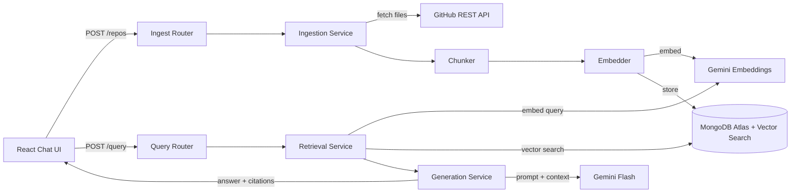

# AI Codebase Assistant

A full-stack RAG (Retrieval-Augmented Generation) application that indexes public GitHub repositories and answers natural-language questions about the code — with citations linking back to the exact file and line number.

## Demo

> _Screenshot / GIF will be added after Phase 9 (Frontend) is complete._

## Features

- 🔍 **Semantic code search** — find relevant code even when you don't know exact function names
- 📚 **Source citations** — every answer links directly to the GitHub file and line range
- 🔄 **Smart chunking** — function/class-boundary-aware splitting for higher retrieval quality
- ⚡ **Hash-based dedup** — unchanged files are never re-embedded on re-index
- 🛡️ **Prompt injection guard** — retrieved code treated as untrusted data

## Architecture



## Tech Stack

| Layer | Technology |
|-------|-----------|
| Frontend | React + TypeScript + Vite + Tailwind CSS |
| Backend | Node.js + Express + TypeScript |
| LLM | Gemini 2.0 Flash |
| Embeddings | text-embedding-004 (768 dims) |
| Vector DB | MongoDB Atlas Vector Search |
| Repo source | GitHub REST API |
| Testing | Vitest + Supertest |
| Deployment | Render (backend) + Vercel (frontend) |

## Setup

### Prerequisites

- Node.js 18+
- MongoDB Atlas account (free M0 cluster)
- Gemini API key ([get one here](https://aistudio.google.com/app/apikey))
- GitHub Personal Access Token (optional, recommended)

### Installation

```bash
# Clone the repo
git clone https://github.com/your-username/ai-codebase-assistant.git
cd ai-codebase-assistant

# Install root dependencies
npm install

# Install client dependencies
cd client && npm install && cd ..

# Install server dependencies
cd server && npm install && cd ..
```

### Environment Variables

```bash
cp .env.example .env
# Edit .env with your actual keys
```

### Running Locally

```bash
# From the root — starts both client and server concurrently
npm run dev

# Or individually:
cd server && npm run dev   # http://localhost:3001
cd client && npm run dev   # http://localhost:5173
```

## Deployment

- **Backend** → [Render](https://render.com) (free Web Service, root: `server`)
- **Frontend** → [Vercel](https://vercel.com) (free, root: `client`)
- **Database** → MongoDB Atlas M0 (free, 512 MB)

## How It Works (RAG Pipeline)

1. **Ingest** — User submits a GitHub repo URL
2. **Fetch** — GitHub REST API returns the file tree and content
3. **Filter** — Binary files, build dirs, and files > 100 KB are skipped
4. **Chunk** — Files are split at function/class boundaries (fallback: 60-line sliding window)
5. **Embed** — Each chunk is embedded with `text-embedding-004` (768-dim vector)
6. **Store** — Vectors + metadata saved to MongoDB Atlas
7. **Query** — User asks a question; question is embedded and used for vector search
8. **Retrieve** — Top-5 most semantically similar chunks are retrieved (filtered by repoId)
9. **Generate** — Gemini Flash receives the chunks as context and generates a grounded answer
10. **Cite** — Answer includes file path, line range, and direct GitHub link

## Known Limitations

- Public GitHub repos only (no private repo support)
- Regex-based chunking may miss complex patterns (no full AST parser)
- Free-tier rate limits apply (GitHub: 60 req/hr unauthenticated; Gemini: per-minute quota)
- Max 5,000 chunks per repo; max repo size 50 MB

## License

MIT
