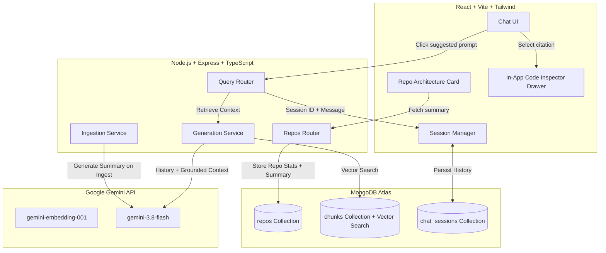

# Phase 2 Implementation Plan: Advanced AI Codebase Assistant

This plan outlines the implementation for the **top 3 high-impact features** selected to elevate the AI Codebase Assistant from a basic RAG prototype into an interactive, portfolio-grade developer tool.

---

## Architecture Overview



---

## 1. Feature Breakdown & Scope

### Feature 1: In-App Code Inspector Drawer
* **Goal:** Eliminate jarring context-switching to external GitHub tabs when exploring citations.
* **UX:** When clicking any citation card below an assistant response, an in-app slide-over panel opens showing:
  - Exact file path and line numbers (`src/auth/jwt.ts:15-42`)
  - Syntax-highlighted code chunk with formatted line numbers
  - One-click copy code button
  - Secondary button to jump directly to the GitHub commit/file line
* **Files Touched:**
  - [`server/src/services/generation.ts`](file:///c:/Users/Hp/Desktop/AIcodebaseAssistant/server/src/services/generation.ts): Enrich `Citation` object with `content` and `language`.
  - [`client/src/types/index.ts`](file:///c:/Users/Hp/Desktop/AIcodebaseAssistant/client/src/types/index.ts): Update `Citation` interface.
  - [`client/src/components/CitationCard.tsx`](file:///c:/Users/Hp/Desktop/AIcodebaseAssistant/client/src/components/CitationCard.tsx): Trigger drawer modal on click.
  - New: `client/src/components/CodeInspectorDrawer.tsx`: Sliding panel UI component.

---

### Feature 2: Multi-Turn Conversational Memory (`chat_sessions`)
* **Goal:** Allow natural, continuous developer dialogue (e.g. *"What does this function do?"* → *"Can you rewrite it with async/await and add tests?"*).
* **Storage:** Persistent `chat_sessions` collection in MongoDB, linked by `repoId`.
* **Prompt Injection Strategy:** Pass the last 4–6 conversation turns formatted as `User:` / `Assistant:` into Gemini's prompt, while preserving the strict prompt injection safety boundary on untrusted code snippets.
* **Files Touched:**
  - New: [`server/src/models/ChatSession.ts`](file:///c:/Users/Hp/Desktop/AIcodebaseAssistant/server/src/models/ChatSession.ts): Mongoose schema for persistent sessions and messages.
  - [`server/src/routes/query.ts`](file:///c:/Users/Hp/Desktop/AIcodebaseAssistant/server/src/routes/query.ts):
    - Accept optional `sessionId` in `POST /api/repos/:repoId/query`.
    - Auto-create or append to session, returning `sessionId`.
    - Add `GET /api/repos/:repoId/sessions/:sessionId` to restore previous threads.
  - [`server/src/services/generation.ts`](file:///c:/Users/Hp/Desktop/AIcodebaseAssistant/server/src/services/generation.ts): Accept `history?: ConversationTurn[]` in `generateAnswer`.
  - [`client/src/hooks/useChat.ts`](file:///c:/Users/Hp/Desktop/AIcodebaseAssistant/client/src/hooks/useChat.ts): Maintain active `sessionId` in state/localStorage.

---

### Feature 3: Auto-Generated Repository Architecture Overview
* **Goal:** Provide instant high-level comprehension as soon as a repository finishes indexing, preventing the "blank canvas" intimidation.
* **Contents:**
  - **Overview:** 2–3 sentence explanation of the system architecture and purpose.
  - **Tech Stack Badges:** Detected frameworks, libraries, and languages (e.g. *React*, *Express*, *MongoDB*, *TypeScript*).
  - **Key Modules Map:** Core entrypoints and components with brief explanations.
  - **One-Click Quick Prompts:** 4 tailored, domain-specific questions that auto-fill and submit in the chat.
* **Files Touched:**
  - [`server/src/models/Repo.ts`](file:///c:/Users/Hp/Desktop/AIcodebaseAssistant/server/src/models/Repo.ts): Add `architectureSummary` field.
  - [`server/src/services/generation.ts`](file:///c:/Users/Hp/Desktop/AIcodebaseAssistant/server/src/services/generation.ts): Implement `generateRepoArchitectureSummary()`.
  - [`server/src/services/ingestion.ts`](file:///c:/Users/Hp/Desktop/AIcodebaseAssistant/server/src/services/ingestion.ts): Generate summary on completion.
  - [`server/src/routes/repos.ts`](file:///c:/Users/Hp/Desktop/AIcodebaseAssistant/server/src/routes/repos.ts): Add `GET /api/repos/:repoId/summary` for instant fetching.
  - New: `client/src/components/RepoOverview.tsx`: Collapsible architecture dashboard component.

---

## 2. API Contracts & Data Models

### Citation Extension
```typescript
export interface Citation {
  filePath: string;
  startLine: number;
  endLine: number;
  githubUrl: string;
  content?: string;  // Raw chunk code for in-app preview
  language?: string; // Language syntax (ts, js, py, etc.)
}
```

### ChatSession Model
```typescript
export interface IChatSession extends Document {
  repoId: Types.ObjectId;
  messages: Array<{
    id: string;
    role: 'user' | 'assistant';
    content: string;
    citations?: Citation[];
    timestamp: Date;
  }>;
  createdAt: Date;
  updatedAt: Date;
}
```

### Architecture Summary Schema
```typescript
export interface RepoArchitectureSummary {
  overview: string;
  techStack: string[];
  keyModules: Array<{
    name: string;
    path: string;
    purpose: string;
  }>;
  suggestedQueries: string[];
}
```

---

## 3. Step-by-Step Execution Sequence

| Step | Action | Focus | Success Criteria |
|---|---|---|---|
| **Step 1** | Implement `CodeInspectorDrawer` | Frontend + Backend | Clicking citation opens slide-over with syntax code without page reload |
| **Step 2** | Integrate `ChatSession` Model & Router | Backend | `POST /query` persists messages and reads prior turns into prompt |
| **Step 3** | Update `useChat` & UI for Multi-Turn | Frontend | Follow-up questions reference earlier parts of the conversation |
| **Step 4** | Implement Architecture Summary Generation | Backend | Ingestion saves structured summary on `Repo` document |
| **Step 5** | Build `RepoOverview` UI Card | Frontend | Shows tech stack tags, architecture overview, and clickable question chips |
| **Step 6** | Automated Test Suite Run | Quality & Reliability | All Vitest suites pass, TypeScript emits 0 errors, build succeeds |

---

## 4. Resilience & Fallbacks

- **Gemini Quota / 429 Handling:** Architecture summary uses non-blocking generation with fallback defaults so ingestion never fails even if quota is temporarily tight.
- **Context Token Budget:** Multi-turn history is capped at the last 6 turns to keep context tightly focused on retrieved code rather than bloat tokens.
- **Drawer Accessibility:** Supports `Escape` key to close, overlay backdrop click, and full keyboard navigation.
